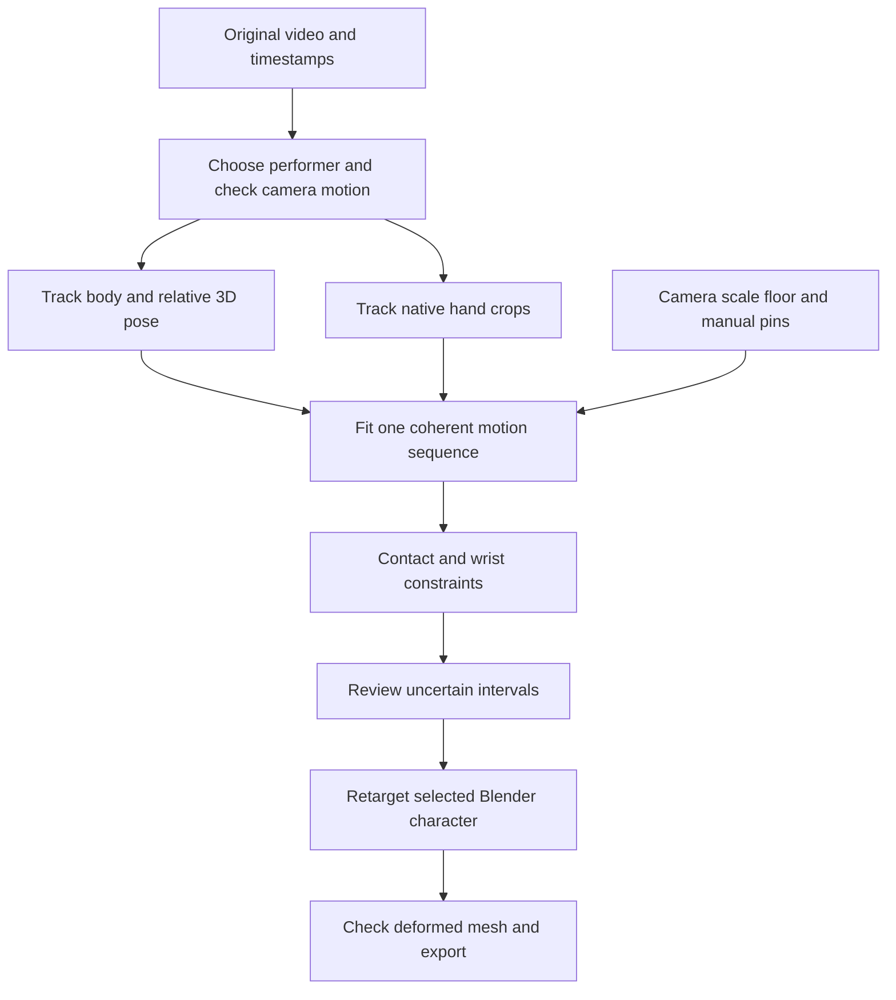

# Single camera motion capture optimization plan

28 November 2026. Analysis baseline: `476a0dc` on `kawshal/bugFix`.

Build a dedicated single-camera workflow with two stages: retain reliable image
observations, then fit a consistent body, hand and root-motion sequence to them.
Start with a stationary camera. Keep the current stack and benchmark RTMW3D as
the first GPU candidate; retain MediaPipe as the fallback. Evaluate SAM 3D Body
in a separate optional worker if its quality, memory use and distribution terms
pass the same gates. Model selection follows measurements on the supplied
recordings, not a claim that one model is already the winner.

The first implementation priority is correct data and review behavior. Current
single-camera output loses useful 2D observations and review metadata, and some
controls do not reach this backend. A faster model alone would retain those
problems.

## Measured baseline

The existing production path was profiled on camera 02, source interval 20–28
seconds, with body, hands and face enabled. It processed 240 source frames and
exported 239 uniformly timed poses at 30 FPS. This cold excerpt took **44.24
seconds**, approximately 5.42 tracked frames per second including initialization,
cleanup and export. These are local measurements, not whole-video predictions.

| Work | Total time | Share of elapsed time |
| --- | ---: | ---: |
| Body inference | 21.10 s | 47.7% |
| Hand crop inference | 17.01 s | 38.5% |
| Face crop processing | 1.16 s | 2.6% |
| Video decode | 0.87 s | 2.0% |
| Other work and initialization | 4.10 s | 9.3% |

Body and hands account for about **86%** of the measured time. Prioritize their
inference and scheduling. Hardware decoding alone cannot remove this bottleneck.

The output reports 84.6% body coverage and 16.7% finger coverage under the current
scorecard definitions. Its 8.84 mm foot-slide figure measures internal
consistency, not true foot placement. The displayed 0.00 px reprojection value
is a placeholder: this path does not calculate that error. It stored zero 2D
camera observation arrays and no review-state snapshot.

Evidence is in `Mcapn_results/single_camera_plan_2026_11_28/baseline_profile.json`,
`input_assessment.json`, `analysis.log` and the bounded excerpt exports. Original
recordings were read directly and were not transcoded or edited.

The compact [baseline JSON](SINGLE_CAMERA_BASELINE_2026_11_28.json) records the
measured environment and results. The [17-task tracker](SINGLE_CAMERA_OPTIMIZATION_TASKS_2026_11_28.csv)
lists implementation dependencies and acceptance gates; all tasks are proposed.

## Input recording assessment

Cached per-camera detections from the earlier three-camera run provide useful
input visibility proxies. They are not measured single-camera 3D accuracy.

| Recording | Source | Body confidence coverage | Median palm width left / right |
| --- | --- | ---: | ---: |
| Camera 01 | 3840 × 2160, about 30 FPS | 87.4% | 32.1 / 30.8 native pixels |
| Camera 02 | 1920 × 1080, about 30 FPS | 97.3% | 17.6 / 27.9 native pixels |
| Camera 03 | 1920 × 1080, about 15.8 FPS | 92.5% | 15.9 / 20.0 native pixels |

Camera 02 is a sensible body-tracking baseline because its confidence proxy is
highest. Its small palms are a difficult finger case. Camera 01 tests whether
native 4K hand crops help. Camera 03 is important for low/VFR timing and different
hand visibility. Camera-local hand estimates were available much more often in
camera 03 than the other views, so pixel size alone cannot rank their hand
quality. Test each recording independently before choosing a preferred view.

## Current implementation findings

| Finding | Location | Required change |
| --- | --- | --- |
| One-video processing always instantiates MediaPipe Heavy | `pipeline.py`, `_run_single_video_cinema` | Honor an explicit single-camera backend and show its actual runtime provider |
| Root tracking is always enabled in this path | Same function | Separate in-place, estimated trajectory and calibrated trajectory modes |
| Lens scale is assumed; depth and travel have fixed clamps | `SingleCamRootTracker` | Use camera/scale inputs and report uncertainty instead of treating heuristic movement as measured meters |
| Feet are grounded independently on every frame | `_mediapipe_world33_to_body26_zup` | Preserve relative vertical motion; estimate one floor and use contact-aware constraints |
| Reprojection is passed as zero without measurement | Single-camera scorecard creation | Show unavailable metrics as N/A and exclude them from grading |
| Raw 2D points and review/source snapshot are absent | Single-camera document construction | Store native observations, identities, timestamps and result dependencies |
| Point edits, exclusions and hand ROIs are explicitly rejected | `run_from_source` single-camera guard | Apply them in a real monocular solver before enabling the controls |
| Live and offline use overlapping but different fallback logic | `live_preview.py`, `app_controller.py`, `pipeline.py` | Share an adapter contract; retain distinct causal preview and offline refinement policies |

Code references: [pipeline](../multi_video_studio/pipeline.py),
[root tracking](../desktop/workers/live_preview.py),
[review](../desktop/ui/widgets/camera_review.py),
[hand tracking](../engine/hands/hand_tracker.py).

## Technology choice

| Component or candidate | Decision | Reason and gate |
| --- | --- | --- |
| PySide6, PyAV, OpenCV, NumPy/SciPy, existing Blender bridge | Keep | Already integrated; supports native timing, review, constraints and verified exports |
| RTMW3D through RTMLib and ONNX Runtime CUDA | First model pilot | Installed RTMLib 0.0.16 already exposes `Wholebody3d` and `RTMPose3d`; benchmark quality and memory before promotion |
| MediaPipe body and crop-based hands | Retain fallback/baseline | Existing runtime works; compare against it rather than removing it before a replacement passes |
| SAM 3D Body with MHR | Optional high-quality pilot | Body, feet, hands and keypoint/mask prompts are relevant; separate worker, checkpoint-access, VRAM and rig-adapter gates apply |
| WHAM | Optional trajectory benchmark | Temporal/world-motion approach; MIT code, but required body-model assets and dependencies need separate checks |
| GVHMR | Research comparison | Useful world-motion/static-camera reference; its license restricts use to educational, research and non-profit purposes |

RTMW3D is an image-based 3D keypoint model, not a complete temporal motion or
world-trajectory solution. Its RTMLib adapter exposes several coordinate outputs.
Inspect and test their units, depth convention, crop transforms and root origin
before converting them to the app's Z-up skeleton. Do not assume the raw returned
array is ready-to-use camera-space meters. The upstream project and adapter are
documented by [OpenMMLab](https://github.com/open-mmlab/mmpose/tree/main/projects/rtmpose3d)
and [RTMLib](https://github.com/Tau-J/rtmlib/blob/main/rtmlib/tools/solution/wholebody3d.py).
The [MMPose](https://github.com/open-mmlab/mmpose/blob/main/LICENSE) and
[RTMLib](https://github.com/Tau-J/rtmlib/blob/main/LICENSE) code licenses are
Apache 2.0; record exact checkpoint provenance, hash and terms separately.

[SAM 3D Body](https://github.com/facebookresearch/sam-3d-body) is a single-image
mesh-recovery model, so video consistency and trajectory still need solving.
Its [installation](https://github.com/facebookresearch/sam-3d-body/blob/main/INSTALL.md)
uses a separate PyTorch environment and access-controlled checkpoints; its
[SAM License](https://github.com/facebookresearch/sam-3d-body/blob/main/LICENSE)
and [MHR](https://github.com/facebookresearch/MHR) requirements are separate
admission checks. Compatibility with this machine's 8 GB GPU has not been measured.

[WHAM](https://github.com/yohanshin/WHAM) documents an Ubuntu/Python 3.9 setup and
separate SMPL/SMPLify downloads despite its MIT code license. Keep that environment
isolated. [GVHMR's license](https://github.com/zju3dv/GVHMR/blob/main/LICENSE)
precludes treating it as an unrestricted default for this app.

## Proposed processing flow

## Work package 1  Correct data and reporting

Persist original frame PTS, source identity, 2D body/hand observations, crop
transforms, model/version/provider and raw relative 3D outputs. Retain their
provenance separately from filtered or predicted poses. Save the review revision
and source-to-animation clock mapping so reopening the same single video works.

Make backend, actor height, in-place/root options and CPU/GPU selection control
the actual worker. Separate unavailable, estimated and measured metrics. A
single-camera fit can have an input-view reprojection residual once its camera
projection is defined; that still does not measure unseen depth accuracy.

MediaPipe's documented world landmarks have their origin at the hip midpoint;
they do not directly provide a measured studio trajectory. See the
[official coordinate description](https://developers.google.com/edge/mediapipe/solutions/vision/pose_landmarker?tab=Python).

**Exit gate:** save/reopen preserves poses, manual corrections and native frame
identity; no invented zero-error fields; actual backend/provider is recorded.

## Work package 2  Benchmark model adapters

Define a common output contract for 2D observations, relative 3D joints, joint
confidence/provenance, actor identity and coordinate transforms. Test axis signs,
left/right identity, scale, crop reversal and mirrored/selfie input explicitly.

Compare the current MediaPipe path with RTMW3D on the same input frames. During
the experiment, evaluate its 2D outputs against the existing RTMW 2D detector.
Avoid running two full body models on every production frame unless that extra
work improves the measured result. Benchmark cold load, warm inference, peak
VRAM and tracking loss on the RTX 3060 Ti.

Admit SAM 3D Body only as an optional worker after access and dependency checks.
Use MHR as a motion/shape prior with a tested canonical-rig adapter; retain the
user's selected Blender character as the export target.

**Exit gate:** a candidate improves annotated visible-joint errors or difficult
intervals without unacceptable speed/memory regressions. Otherwise retain the
baseline and improve the solver around it. No candidate is currently proven best
on these recordings.

## Work package 3  Solve stable root and body motion

For the first release, require a stationary-camera mode and offer optional camera
intrinsics, performer height and a floor reference. Fit actor scale/bone lengths
once from reliable frames. Preserve jumps and crouches; remove the per-frame
floor reset. Fit root translation, orientation and joints across overlapping
windows using image residuals, bone lengths, joint limits, temporal continuity
and foot-contact evidence.

Use confidence-weighted robust losses so an uncertain wrist does not drag the
whole actor. Distinguish planted feet, pivots, swing and flight. Use soft contact
transitions and preserve deliberate fast motion. Reset tracking at cuts or
identity changes. Long hidden intervals may be predicted, but remain labeled
estimated and queued for review rather than counted as observations.

Offer **In place**, **Estimated movement** and **Calibrated movement**. Estimated
scale/root must be labeled. Moving-camera support follows after the static mode
passes: estimate background camera motion independently and avoid treating a pan
or zoom as actor movement. If camera motion is unreliable, offer in-place output
and a clear review state rather than claiming a measured world path.

**Exit gate:** annotated crouches/jumps survive; no stationary-camera root jumps
or unexplained depth flips; short/tall rig proportions retain stable bone lengths.

## Work package 4  Improve hands and character contacts

Decode hand crops from the original frame rather than an already reduced body
preview. Track crop position/scale with the wrist, retain side identity during
crossing, and re-detect on loss. Show crop size and ambiguity. Upsampling a tiny
palm must not increase its claimed observation confidence.

Fit palm orientation and fingers as a consistent sequence with fixed lengths and
joint limits. Distribute forearm roll separately from wrist articulation. Apply
body/hand manual pins, crop overrides and short depth-order hints in this solver;
do not simply remove the existing single-camera guard.

After retargeting, use the chosen character's collision proxies for correction
and evaluate its deformed mesh for remaining penetrations. Keep intentional
touches distinguishable from unwanted intersections, with editable correction
copies and residual-contact reports. Hidden fingers cannot be made reliably
observed by adding a smoother.

**Exit gate:** curated hand-crossing, palm-up/down and self-contact intervals have
no unexplained side swaps or wrist flips; uncertain finger poses remain visible
in the review report; original and corrected actions remain recoverable.

## Work package 5  Optimize measured costs

Keep detector/model sessions alive. Track the performer ROI each frame and test
less frequent full-frame person detection, initially every 6–10 frames with
immediate re-detection on loss. Bound decode queues to a few frames. Batch the
two hand crops only if the measured memory/performance tradeoff is worthwhile.

Cache raw detections by source fingerprint, model hash and preprocessing settings.
Recompute corrected ranges and their temporal overlap after manual edits rather
than redoing the whole video. Cache keys must include crop/model changes while
allowing pose cleanup to reuse valid raw inference. Preserve cancellation and
the existing staged export publication.

Evaluate FP16 or ONNX Runtime device-buffer reuse after correctness tests; use
[I/O binding](https://onnxruntime.ai/docs/performance/tune-performance/iobinding.html)
only where profiling shows avoidable transfers. Face processing is a smaller
measured cost here, so preserve it while prioritizing body and hands.

Initial goals, not measured outcomes: at least **2× faster** than the same
44.24-second cold excerpt without quality regression; body-only preview near
real time; Studio processing within about 3× clip duration for the core adapter.
On the 8 GB GPU, test a working-set budget around 6 GB with Blender closed and
adapt downward to available memory. Show actual provider, speed and peak memory.

## Work package 6  Deliver a focused single video interface

Use a workflow of **Video → Performer and camera → Analyze → Body and hands →
Character and export**. Single-camera input skips multi-video synchronization.
Camera intrinsics, scale and floor setup remain useful.

Reuse the existing independent zoomable previews, native hand crops, point names
and selected-window state. Add an uncertainty timeline for tracking loss, small
hands, depth ambiguity and likely contact problems. Corrections should re-solve
a selected interval with context, with raw/cleaned comparison and undo.

Physical markers in one view may help 2D identity. A known-size floor board can
help pose/scale with suitable intrinsics. Neither turns a single image ray into
multi-view triangulation. Keep that distinction clear in the marker controls.

## Work package 7  Validate and release

Run each supplied recording as the sole inference input. Use its other aligned
views only as held-out consistency checks. Report any prior calibration or
coordinate alignment used by evaluation; never present the existing multi-view
reconstruction as ground-truth mocap. Test uncalibrated and calibrated cases
separately, then add controlled stationary, jump, crouch, turn and hand gestures.

| Gate | Proposed acceptance |
| --- | --- |
| Visible-joint fit | No regression on annotated input frames; target at least 20% lower P95 error in difficult visible intervals |
| Stillness and motion fidelity | Target 50% lower static-segment jitter while preserving labeled motion range and timing |
| Identity and depth | Zero unexplained left/right swaps in the curated crossing tests; ambiguous intervals flagged |
| Feet | Test labeled stance/flight; target P95 stance drift below 20 mm only where scale is verified; otherwise use image-space checks |
| Timing and data | VFR, drops, trims, mirrored video and save/reopen retain native identity and playback duration |
| Responsiveness | Detection/solve/export cancellation, incremental edits and old-result preservation pass |
| Blender/export | Body/fingers/face, scale and hierarchy survive FBX/GLB round trips at integer and halfway poses; mesh contacts reported separately |
| Compatibility | Existing 151-test checkpoint and new monocular cases pass; no changes to old multi-camera results without an explicit new solve |

The numerical goals are starting acceptance targets to calibrate against labels,
not claims of achieved accuracy. Publish quality and timing per backend, clip and
hardware. Keep a feature flag and the old fallback until the core adapter passes
full-clip and packaged Windows checks.

## Delivery order

Ship work packages 1–2 first: trustworthy saved observations/review and the model
comparison. Then complete static-camera root/body, hands and range corrections.
Optimize the measured path and release it with Blender validation. Add the
optional high-quality backend and moving-camera mode after their separate gates.

Do not train a new general model as the first step. The supplied views are useful
tests of one performance, not a diverse training set. Consider fine-tuning only
after labeling recurring failures, separating performers/motions/cameras between
training and evaluation, and showing a gain over the pretrained alternatives.
